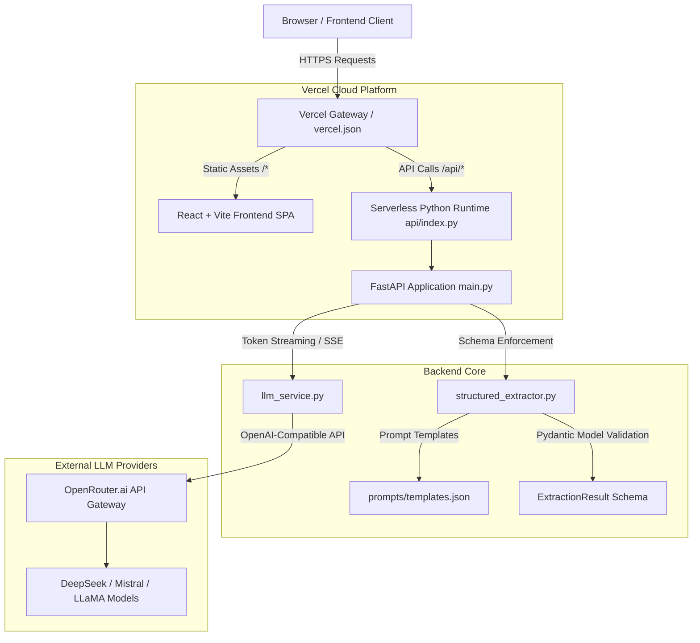

# Smart Extractor & Chat Service

[](https://fastapi.tiangolo.com)
[](https://react.dev)
[](https://www.python.org/)
[](https://openrouter.ai/)
[](https://vercel.com)
[]()

An end-to-end fullstack AI platform that leverages Large Language Models (LLMs) to provide real-time token-streaming conversational assistance and automated, schema-validated structured information extraction from arbitrary natural language text.

---

## Architecture Overview



---

## Key Features

- **Real-Time Word-by-Word Streaming**: Server-Sent Events (SSE) streaming for AI Chat responses and live text extraction.
- **Strict Structured Output Extraction**: Converts unstructured articles, meeting transcripts, job postings, or announcements into validated JSON with:
  - `title`: Extracted concise title
  - `summary`: High-level summary of key points
  - `keywords`: Array of topical tags and named entities
  - `category`: Domain classification (e.g., Technology, Healthcare, Finance)
- **Automatic Fallback & Self-Correction**: Multi-pass prompt retry and JSON repair logic strips `<think>` chains, safety disclaimers, and markdown code blocks.
- **Modern Responsive Glassmorphic UI**: High-contrast dark theme built with React, CSS variables, and persistent local history for both Chat and Extractions.
- **Monorepo Unified Deployment**: Deployed 100% free on Vercel without requiring a credit card, using Vercel Serverless Functions and Vite asset routing.
- **Cost & Token Telemetry**: Tracks prompt tokens, completion tokens, and estimated cost per request.

---

## Repository Structure

```text
Smart-Extractor-Chat-Service/
├── api/
│   └── index.py                     # Vercel Serverless Python entrypoint
├── frontend/                        # React + Vite web application
│   ├── src/
│   │   ├── App.jsx                  # Main UI container (Chat & Extractor modes)
│   │   ├── App.css                  # Custom glassmorphic styling & animations
│   │   ├── index.css                # Global CSS variables and tokens
│   │   └── main.jsx                 # React root renderer
│   ├── package.json                 # Node dependencies and build scripts
│   ├── vite.config.js               # Vite config with local /api dev proxy
│   └── .env.example                 # Frontend environment configuration
├── python_lab/                      # FastAPI Backend & LLM Core
│   ├── main.py                      # FastAPI application with unified APIRouter
│   ├── llm_service.py               # OpenRouter client, streaming, cost tracking
│   ├── structured_extractor.py      # Schema enforcement and extraction pipeline
│   ├── evaluate_extractor.py        # 10-document empirical evaluation benchmark
│   ├── evaluation_dataset.json      # Benchmark dataset across diverse industries
│   ├── evaluation_results.json      # Output validation benchmark results
│   ├── token_count.py               # Token counting & estimation utility
│   ├── prompts/
│   │   └── templates.json           # Version-controlled prompt templates
│   ├── requirements.txt             # Python backend dependencies
│   └── test_*.py                    # Complete test suite (30 automated tests)
├── vercel.json                      # Vercel unified fullstack deployment config
├── requirements.txt                 # Root dependencies for Vercel deployment
├── PROMPT_ENGINEERING_REPORT.md     # 10-document evaluation benchmark report
├── BAD_PROMPTS.md                   # Systematic prompt failure analysis
├── DEPLOYMENT.md                    # Zero-credit-card live deployment guide
└── README.md                        # Master project documentation
```

---

## Tech Stack

| Layer | Technologies |
|---|---|
| **Frontend** | React 18, Vite, React Markdown, CSS3 / Custom Glassmorphism |
| **Backend API** | Python 3.11+, FastAPI, Uvicorn, Starlette, Pydantic v2 |
| **LLM Gateway** | OpenRouter API (OpenAI-compatible client), OpenRouter Free Models |
| **Streaming Protocol** | Server-Sent Events (SSE) via `text/event-stream` |
| **Testing** | Pytest, unittest.mock, AnyIO, HTTPX TestClient |
| **Hosting & Cloud** | Vercel Serverless Python Runtime (`@vercel/python`) + Vercel Edge CDN |

---

## API Reference

Base URL (Local): `http://127.0.0.1:8000`  
Base URL (Vercel): `https://your-deployment.vercel.app/api`  
Interactive Swagger Docs: `/docs` or `/api/docs`

### 1. Health Check
- **Endpoint:** `GET /health` (or `GET /api/health`)
- **Response:**
  ```json
  {
    "status": "healthy"
  }
  ```

### 2. Structured Extraction (Synchronous)
- **Endpoint:** `POST /extract` (or `POST /api/extract`)
- **Headers:** `Content-Type: application/json`
- **Request Body:**
  ```json
  {
    "text": "OpenAI announced a new reasoning model designed to solve complex multi-step math and coding problems with step-by-step verification."
  }
  ```
- **Response (200 OK):**
  ```json
  {
    "title": "OpenAI Reasoning Model Announcement",
    "summary": "OpenAI introduced a reasoning model focused on complex math and coding problem solving using verification.",
    "keywords": ["OpenAI", "Reasoning Model", "Artificial Intelligence", "Coding"],
    "category": "Technology"
  }
  ```

### 3. Structured Extraction (Streaming SSE)
- **Endpoint:** `POST /extract/stream` (or `POST /api/extract/stream`)
- **Headers:** `Content-Type: application/json`
- **Response:** `text/event-stream`
- **Events Emitted:**
  - `data: {"chunk": "{\"title\": \"OpenAI..."}`: Live partial tokens.
  - `data: {"done": true, "result": { ... }}`: Fully parsed, schema-validated object.

### 4. Interactive Chat (Synchronous)
- **Endpoint:** `POST /chat` (or `POST /api/chat`)
- **Request Body:**
  ```json
  {
    "message": "Explain Retrieval-Augmented Generation in two sentences.",
    "system_instruction": "You are a concise computer science professor."
  }
  ```
- **Response (200 OK):**
  ```json
  {
    "reply": "Retrieval-Augmented Generation (RAG) is an AI framework that retrieves factual documents from an external knowledge base before generating a response. This grounds the language model's output in verifiable facts and significantly reduces hallucinations."
  }
  ```

### 5. Interactive Chat (Streaming SSE)
- **Endpoint:** `POST /chat/stream` (or `POST /api/chat/stream`)
- **Headers:** `Content-Type: application/json`
- **Response:** `text/event-stream`
- **Events Emitted:**
  - `data: {"chunk": "Retrieval"}`
  - `data: {"chunk": "-Augmented"}`
  - `data: {"done": true}`

---

## Local Development Setup

### Prerequisites
- Python 3.11+
- Node.js 18+ and npm
- OpenRouter API key ([Get a free key here](https://openrouter.ai/keys))

### Step 1: Clone the Repository
```bash
git clone https://github.com/shoaib980-make/Smart-Extractor-Chat-Service.git
cd Smart-Extractor-Chat-Service
```

### Step 2: Configure the Backend
```bash
cd python_lab
python -m venv .venv

# On Windows (Git Bash):
source .venv/Scripts/activate
# On Windows (PowerShell/CMD):
.venv\Scripts\activate
# On macOS/Linux:
source .venv/bin/activate

pip install -r requirements.txt
```

Create `.env` inside `python_lab/`:
```env
OPENROUTER_API_KEY=your_openrouter_api_key_here
OPENROUTER_MODEL=openrouter/free
OPENROUTER_INPUT_PRICE_PER_MILLION=0
OPENROUTER_OUTPUT_PRICE_PER_MILLION=0
```

Start the FastAPI server:
```bash
uvicorn main:app --reload --port 8000
```
API will be live at `http://127.0.0.1:8000` with Swagger docs at `http://127.0.0.1:8000/docs`.

### Step 3: Run the React Frontend
In a new terminal:
```bash
cd frontend
npm install
npm run dev
```
Open `http://localhost:5173` in your browser. Vite's built-in dev proxy automatically forwards `/api/*` calls to `http://127.0.0.1:8000`.

---

## Automated Testing Suite

The repository contains 30 comprehensive unit and integration tests covering API routes, Pydantic validation, error handling, mock LLM generation, and prompt retries.

Run the test suite from `python_lab/`:
```bash
python -m pytest -v
```

### Test Coverage Highlights
- **`test_api.py`**: Verifies `/health`, `/extract`, `/extract/stream`, `/chat`, and `/chat/stream` status codes and responses.
- **`test_structured_output.py`**: Validates schema enforcement, mandatory fields, forbidden extra properties, and JSON parser sanitization.
- **`test_error_handling.py`**: Simulates HTTP 502/500 errors, rate-limiting, and network timeouts.
- **`test_prompt_retry.py`**: Validates self-healing retry logic when the model returns malformed JSON or invalid types.
- **`test_llm_service.py`**: Mocks OpenRouter completions, system instructions, and token limit controls.

---

## Evaluation Benchmark

The extraction accuracy is empirically measured using [`python_lab/evaluate_extractor.py`](file:///c:/Users/Admin/projects/Smart-Extractor-Chat-Service/python_lab/evaluate_extractor.py) on a 10-document real-world dataset ([`python_lab/evaluation_dataset.json`](file:///c:/Users/Admin/projects/Smart-Extractor-Chat-Service/python_lab/evaluation_dataset.json)):

```bash
cd python_lab
python evaluate_extractor.py
```

### Benchmark Results
- **Benchmark Documents:** 10 diverse domains (Healthcare, Agriculture, Logistics, Tech, Finance, etc.)
- **Final Schema Conformance:** **100.0% (10/10)**
- **Average Extraction Latency:** ~1.8s
- **Detailed Findings:** Read the full [Prompt Engineering & Evaluation Report](PROMPT_ENGINEERING_REPORT.md) and [Bad Prompts Analysis](BAD_PROMPTS.md).

---

## Live Deployment (100% Free on Vercel)

Both the React UI and the Python FastAPI backend are deployed together on Vercel using Serverless Functions **with NO credit card required**.

For complete step-by-step instructions, see [`DEPLOYMENT.md`](DEPLOYMENT.md).

### Quick Summary:
1. Push code to GitHub:
   ```bash
   git add .
   git commit -m "Deploy fullstack application to Vercel"
   git push origin main
   ```
2. Import repository in [Vercel](https://vercel.com).
3. Ensure **Root Directory** is `./`.
4. Add Environment Variables in Vercel:
   - `OPENROUTER_API_KEY`: `your_key`
   - `OPENROUTER_MODEL`: `openrouter/free`
   - `VERCEL_FORCE_PYTHON_STREAMING`: `1`
5. Click **Deploy**.

---

## Security & Best Practices

- **Zero Secrets in Code**: All API credentials reside in environment variables and are excluded via `.gitignore`.
- **Input Validation**: Text length is capped (`10,000` chars for extraction, `5,000` chars for chat) to prevent token abuse and denial-of-service.
- **Defensive Parsing**: Strips reasoning chains (`<think>...</think>`) and safety prefixes before returning answers to users.
- **CORS Protection**: Restricted allowed origins and regex matching for Vercel production and preview deployments.

---

## Author

**Shoaib Asghar**  
BS Computer Science Graduate — Information Technology University (ITU), Lahore  

- **GitHub:** [@shoaib980-make](https://github.com/shoaib980-make)  
- **Repository:** [Smart-Extractor-Chat-Service](https://github.com/shoaib980-make/Smart-Extractor-Chat-Service)
